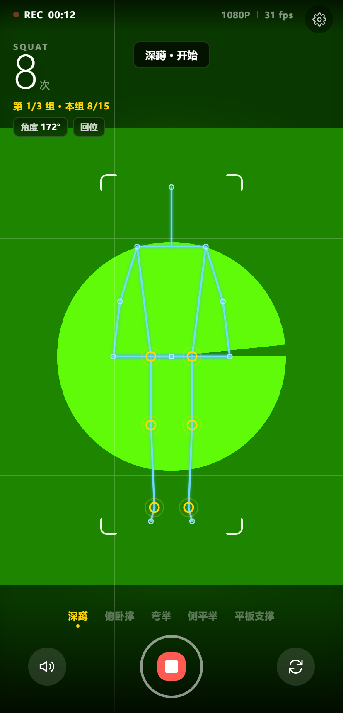

# 姿势教练 · Pose Coach

手机浏览器打开就能用的 AI 健身动作识别器。摄像头实时捕捉 33 个人体关键点，自动计数、纠正动作，**全部在本机计算，画面不上传**。

不需要装 App，不需要账号，不需要联网分析。



## 能做什么

| 动作 | 判定依据 |
|---|---|
| 深蹲 | 髋-膝-踝夹角，蹲到底 <105°，站直 >158° |
| 俯卧撑 | 肩-肘-腕夹角，下放 <95°，撑起 >155° |
| 弯举 | 肩-肘-腕夹角，弯到位 <62° |
| 侧平举 | 髋-肩-肘夹角，抬起 >78° |
| 平板支撑 | 肩-髋-膝成一条直线，按秒计时 |

**动作纠错**：膝盖内扣、塌腰、翘臀、幅度不足、蹲太浅
**站位引导**：脚未入镜、距离太远/太近，直接提示调整
**训练闭环**：自由练或定目标（组数 × 每组量）→ 组间休息 → 完成总结 → 今日记录

## 在手机上用

1. 用 **Safari 或 Chrome** 打开页面（微信内置浏览器拿不到摄像头权限）
2. 点快门 → 允许摄像头
3. 手机架起来，**退后 2 米，全身和脚入镜**
4. 选动作 → 开始练

首次加载约 24MB（模型 + 推理引擎），建议 WiFi，之后走缓存。

## 本地运行

```bash
npm run fetch-assets   # 下载 MediaPipe 运行时与模型（约 24MB）
npm start              # 启动本地服务
```

打开 http://localhost:8899

> 摄像头需要 HTTPS 或 localhost。用手机访问电脑的局域网 IP 时，浏览器会拦截摄像头，需要自己配证书或部署到 HTTPS。

## 技术实现

- **推理**：MediaPipe Tasks Vision（`pose_landmarker_lite`），WebAssembly + WebGL
- **角度计算**：优先使用 `worldLandmarks`（米制 3D 坐标），避免 2D 投影带来的透视畸变
- **平滑**：关节坐标与角度双自适应 EMA，动作快时跟得上、静止时不抖（实测抖动 6.28° → 1.05°）
- **计数**：关节角状态机 + 滞回阈值，幅度不足不计入
- **零依赖**：没有前端框架、没有构建步骤、没有 npm 运行时依赖

```
src/
  config.js      配置常量
  math.js        角度、距离、平滑滤波
  exercises.js   动作定义与判定规则
  counter.js     计数状态机（纯逻辑，返回事件）
  workout.js     组数、休息、完成、总结
  pose-engine.js 模型加载（含降级）+ 摄像头
  renderer.js    骨架绘制与对焦框
  voice.js       语音播报
  store.js       本地记录
  main.js        流程组装
```

## 已知限制

- **单目摄像头**：只有 2D 画面 + 估算深度，侧面看不到的三维问题（如膝关节内扣）判不出来
- **需要固定机位**：手机要架稳，手持或走动会失效
- **iOS 不支持变焦**：`MediaStreamTrack` 的 `zoom` 约束在 Safari 上不可用，只能靠移动手机
- **模型是 lite 版**：为速度牺牲了精度，换 `pose_landmarker_full` 可提升准确度但帧率下降
- **数据只在本机**：记录存 localStorage，换设备或清浏览器数据就没了

## 许可

代码 MIT。内置的 MediaPipe 运行时与模型为 Apache-2.0，详见 [NOTICE](NOTICE)。
